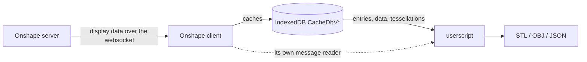

# Onshape mesh export

A userscript that saves the triangle mesh Onshape's web client received for each part. It works in Part Studios and Assemblies and writes binary STL, OBJ or raw JSON.

The meshes are the ones the Onshape viewer draws, not a new tessellation from the REST API. The client keeps every display-data message it receives in an IndexedDB cache. The script reads that cache and decodes the messages with the client's own message reader. It doesn't use API keys or API quota.

## Install

1. Install a userscript manager: [Violentmonkey](https://violentmonkey.github.io/) or Tampermonkey.
2. Open the [raw userscript](https://raw.githubusercontent.com/MangoSwirl/onshape-mesh-export/main/dist/onshape-mesh-export.user.js) and accept the install prompt. Your userscript manager will then keep it up to date.

## Use

1. Open a Part Studio or Assembly tab in Onshape and let the model finish loading.
2. Click **Export meshes** at the bottom left.
3. Click ↓ next to a part to download it, or tick parts and click **Download selected**.

| Option | Effect |
|---|---|
| Format | STL (binary); OBJ (vertices welded, one `o` group per part); raw JSON (each face's float32 points, normals and triangle-strip indices as the client holds them, in metres) |
| Units | mm (default), m or in. Onshape works in metres; STL and OBJ are scaled. |
| One file | Puts every chosen part in a single file instead of one file each. |
| Keep assembly positions | Assemblies only. On (default): each part is placed where the assembly shows it. Off: each part stays in its own Part Studio coordinates. |

- **Part Studio:** one row per part, named as in Onshape. Hidden parts start unticked.
- **Assembly:** one row per part instance at every subassembly depth, named by its instance path (for example `Assembly 2 <1> › Shaft <1>`). Each instance uses the geometry of its own configuration.

## How it works



- **Part Studio record:** `display.GBTPartStudioDisplayData`. It lists the parts (`partDisplayData`) and the faces that make up each part (`deterministicPartIdToData[partId].entityDIds`).
- **Per-part tessellation records:** each one holds the face meshes for one part, as `GBTEntityFace {points, normals, indices}`. The points are float32 xyz in metres, and the indices are triangle strips joined by repeated indices. When the client holds a face at more than one tessellation setting, the script uses the finest.
- **Assembly record:** `assemblydisplay.GBTRootAssemblyDisplayData`. Each occurrence gives its part IDs, the world transform the viewer draws it with, and the Part Studio microversion and configuration its geometry is cached under.
- **Instance names:** the cache doesn't keep them, so the script reads them with one REST call to the assembly definition. If that call fails, it labels instances by part name.

## Limits

- **Loaded parts only.** The script only exports parts the viewer has loaded. A part that is hidden, or still loading, may have no triangles yet; the panel names any part it couldn't export.
- **Onshape internals.** The script relies on the client's internals: the `CacheDbV*` record layout, and a webpack module that contains `readMessage` and `extractStringTable`. It finds the reader by that signature, not by module number, but an Onshape update could still break it.
- **GPU-buffer mode is untested on B-rep parts.** When Onshape's `USE_DISPLAY_DATA_GPU_BUFFERS` capability is on, parts are cached as GL buffers. The script reads that layout, but it has only been checked on one mesh part (a tetrahedron).

## Develop

```sh
npm run build   # writes dist/onshape-mesh-export.user.js
npm test
```

| File | What it does |
|---|---|
| `src/client.js` | Turns decoded client display data into triangles. Pure functions. |
| `src/mesh.js` | Writes STL and OBJ, applies transforms, parses URLs, and builds instance names from the REST definition. |
| `src/userscript.js` | Finds the client's reader, reads IndexedDB, and runs the panel. |

The tests use data decoded from a live Onshape client. They check:

- volumes against Onshape's mass properties;
- that box parts come out as closed solids with outward-facing triangles;
- the configuration keys;
- the world transforms of nested occurrences;
- the GL-buffer layout.

The build sets `@downloadURL` and `@updateURL` to the raw file on `main`. Set `DOWNLOAD_URL` to point at another copy.

To release, bump `version` in `package.json` and rebuild. Then commit `dist/`. Userscript managers pick up the new version from `main`.
